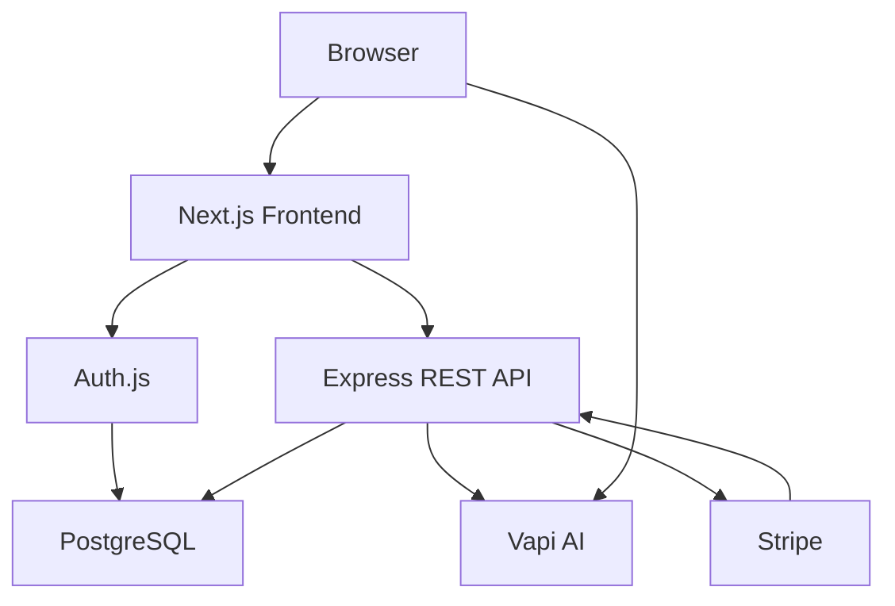

# KnowledgeHub-AI

An interactive full-stack AI learning platform that enables users to create personalised AI tutors, participate in real-time voice sessions and manage their learning journey.

## Features

- Create, search, filter and manage personalised AI companions.
- Real-time AI voice tutoring with live transcripts using Vapi.
- Email/password and Google authentication with Auth.js.
- Personal learning history and companion management.
- Free, Pro and Premium subscription tiers with server-side usage limits.
- Stripe sandbox checkout, billing portal and webhook integration.
- Voice usage reservation and reconciliation based on actual call duration.

## Technology stack

| Layer | Technologies |
|---|---|
| Frontend | Next.js, React, TypeScript, Tailwind CSS, shadcn/ui |
| Backend | Node.js, Express.js, TypeScript, REST APIs |
| Database | PostgreSQL, SQL, node-postgres |
| Authentication | Auth.js, bcrypt, JWT, Google OAuth |
| Integrations | Vapi AI, Stripe |
| Testing | Jest, React Testing Library, API integration checks |
| Infrastructure | Docker, Docker Compose, GitHub Actions CI |

## Architecture



The Next.js server authenticates users and issues short-lived signed tokens for protected backend requests. Express validates tokens, enforces companion ownership and subscription limits, and manages database operations. PostgreSQL stores account, companion, learning history, subscription and voice usage records.

## Local setup

Prerequisites: Node.js 24, npm, Docker and Docker Compose.

1. Clone the repository and enter the project directory.
2. Copy `.env.example` to `.env.local` and `backend/.env.example` to `backend/.env`. Populate credentials using your own provider accounts. Use the same `API_JWT_SECRET` in both files.
3. Initialise the local database:

```bash
docker volume create backend_postgres_data
docker compose up -d db
```

Wait for PostgreSQL to become healthy (`docker compose ps`), then run the schema scripts in dependency order against the local database:

```bash
for file in create_auth_tables.sql create_companions.sql create_session_history.sql create_subscriptions.sql create_voice_usage.sql; do
  docker exec -i knowledgehub-postgres psql -U knowledgehub -d knowledgehub_db -v ON_ERROR_STOP=1 < "backend/sql/$file" || break
done
```

Confirm every script succeeds before continuing.

```bash
docker compose up --build -d
docker compose ps
```

- Frontend: http://localhost:3000
- Backend health: http://localhost:5000/api/health
- Database health: http://localhost:5000/api/db-health

Configure the Google OAuth callback as `http://localhost:3000/api/auth/callback/google`. For local Stripe webhook testing, use the Stripe CLI to forward sandbox events to `http://localhost:5000/api/stripe/webhook` and configure the corresponding signing secret.

## Database design

| Tables | Responsibility |
|---|---|
| users, accounts, sessions, verification_token | Authentication |
| companions | AI tutor configuration |
| session_history | Learning activity |
| subscriptions, stripe_webhook_events | Billing state and webhook deduplication |
| voice_usage | Reserved and consumed voice time |

## API overview

| Endpoint | Purpose |
|---|---|
| GET /api/health | Service health |
| GET /api/db-health | Database connectivity |
| GET / POST /api/companions | List or create companions |
| GET / PATCH / DELETE /api/companions/:id | Read, update or delete a companion |
| GET /api/companions/permissions | Companion allowance |
| GET /api/sessions/me | Personal session history |
| POST /api/sessions | Record learning activity |
| GET /api/stripe/subscription | Current subscription |
| POST /api/stripe/webhook | Signed billing events |
| GET /api/voice/permissions | Voice allowance |
| POST /api/voice/call/web | Create a voice call |

Protected endpoints require a valid backend JWT. Mutation endpoints enforce the applicable ownership and subscription rules.

## Testing

```bash
npm ci
npx tsc --noEmit
npm run test:ci
npm run build
cd backend
npm ci
npm run build
node scripts/test-subscription-limits.cjs
```

The subscription integration script requires a running local backend and local development database. GitHub Actions defines automated frontend and backend checks.

## Project status

This project is a portfolio application. Stripe payments operate in sandbox mode and are not real charges. Voice provider usage may incur costs. Public deployment requires appropriate provider credentials, spend controls, and production environment configuration. Abandoned voice reservations may require manual reconciliation. The local Docker frontend runs in development mode.
